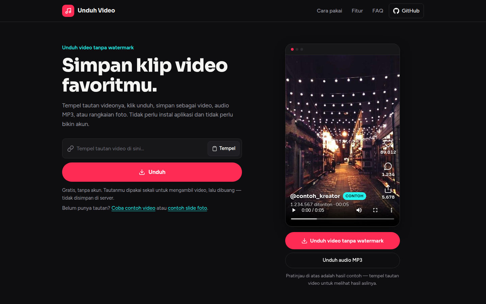
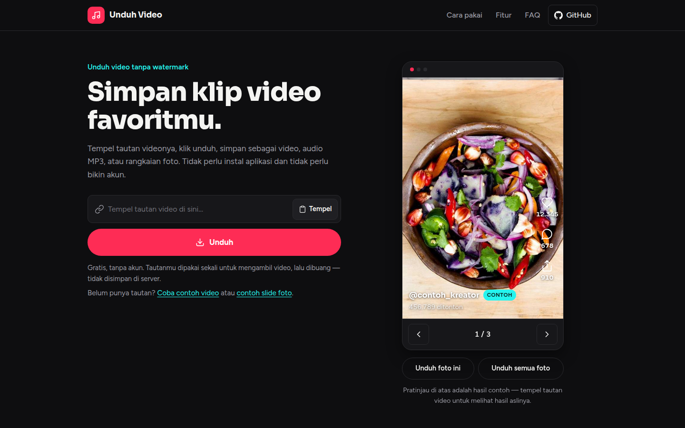
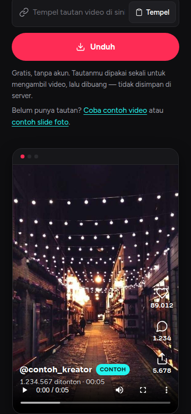

# Unduh Video

Tempel tautan video, unduh videonya tanpa watermark, audionya sebagai MP3, atau slide fotonya. Gratis, tanpa akun, tanpa aplikasi.

## Live Demo

**https://unduh-video.pages.dev**







Video demo: [docs/demo/demo.mp4](docs/demo/demo.mp4)

## Fitur

- **Video tanpa watermark** — MP4 kualitas asli, pratinjau di pemutar 9:16 dengan rel aksi.
- **Audio MP3** — suara videonya saja, tombol muncul hanya bila tersedia.
- **Slide foto** — slider geser + counter, unduh per foto atau semuanya sekaligus.
- **Tempel dari clipboard** — satu klik, tanpa ketik manual.
- **Mode contoh** — hero langsung menampilkan hasil contoh berlabel "Contoh" supaya alat bisa dicoba tanpa tautan.
- **Error yang jelas** — tautan salah, video privat/dihapus, atau resolver mati: banner inline berbahasa Indonesia, halaman tetap hidup.

## Cara jalan (lokal)

```bash
npm install
npm run build   # -> dist/ (public/* + worker/_worker.js)
npm run serve   # http://127.0.0.1:8331
```

Perintah lain:

| Perintah | Fungsi |
|---|---|
| `npm test` | Unit test worker (`node:test`, 11 tes) |
| `npx playwright test` | E2E desktop + mobile (butuh `npm run build` dulu) |
| `npm run validate` | Tautan + secret + gate anti-slop P0 |
| `npm run sweep` | Advisory sweep OSV (produksi saja) |
| `npm run smoke` | Smoke folder `dist/` (yang di-deploy) |
| `npm run screenshots` | Screenshot dokumentasi (Chromium cache lokal) |
| `npm run make-video` | Rangkai screenshot jadi `docs/demo/demo.mp4` |

## Tech Stack

- **Frontend:** HTML/CSS/JS tanpa framework (`public/`). Font Sora + Figtree.
- **Backend:** Cloudflare Pages Worker satu file tanpa dependensi
  (`worker/_worker.js`) — menyajikan situs statis + tiga endpoint:
  `GET /api/status`, `GET /api/demo?type=video|photo`,
  `GET /api/download?url=…` (resolve lewat savett.cc, parse regex).
- **CI:** GitHub Actions — build, worker-test, static-checks,
  advisory-sweep (OSV batch, tanpa auth), playwright-e2e, smoke. Node 24.

## Struktur Proyek

```
public/                  # situs statis: index.html, style.css, app.js, favicon.svg
worker/                  # _worker.js (Pages Worker) + _worker.test.mjs + fixtures/
scripts/                 # build, serve-worker, check-*, smoke, screenshot, make-video, advisory-sweep
e2e/                     # Playwright: landing + demo video/foto + validasi
docs/                    # PRD turunan, DESIGN.md, ARCHITECTURE.md, diagrams.html, demo, screenshots
.github/workflows/ci.yml
```

## Dokumentasi

- [PRD](PRD.md) · [Arsitektur](docs/ARCHITECTURE.md) · [Kontrak desain](docs/DESIGN.md)
- [Diagram](docs/diagrams.html) (HTML+SVG) · [Testing](docs/testing.md) · [Deploy](docs/deploy.md)
- [CHANGELOG](CHANGELOG.md)

## Catatan restructure (PR #1)

App lama nyangkut di subfolder `tiktok-downloader--main` dan tidak bisa
jalan dari root. PR ini memindahkan isinya ke root:

- `tiktok-downloader--main/public/*` → `public/*` (ditulis ulang total).
- `tiktok-downloader--main/api/download.js` (Vercel + axios + cheerio) →
  `worker/_worker.js` (Pages Worker, fetch + regex, tanpa dependensi,
  bentuk respons sama). Perbaikan parser: label "MP4 No Watermark" dulu
  salah masuk golongan watermark karena mengandung kata "watermark".
- `tiktok-downloader--main/README.md` hanya berisi satu baris terpotong
  (`# tiktok-downloader-`) — dibuang; README root yang dipakai dan ditulis
  ulang. README root lama menyebut demo
  `915a22db.tiktok-downloader-f3g.pages.dev` (deploy lama) — diganti URL
  baru setelah deploy.
- `package.json` lama (axios + cheerio) dihapus — nol dependensi produksi.
- Tidak ada secret yang ter-commit di repo lama (diperiksa: tanpa `.env`,
  tanpa kunci/API key).

## Lisensi

MIT — lihat [LICENSE](./LICENSE).

---
_Dikembangkan oleh **dezzorigin** (Nabil Aulia Dika)._
